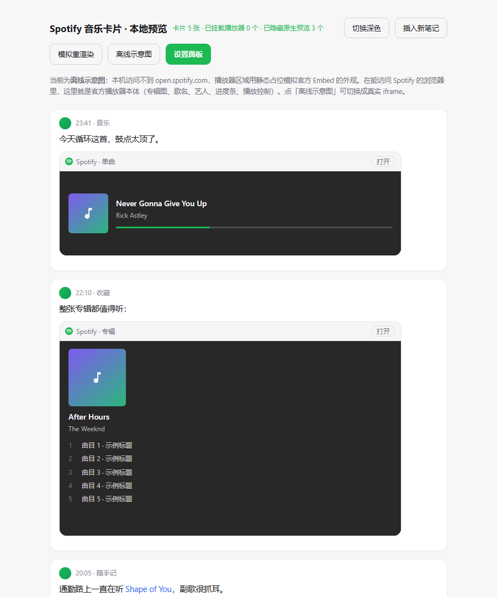
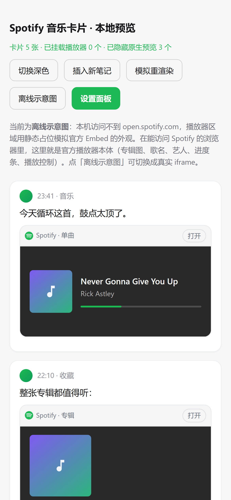

# Blinko Spotify 音乐卡片

在 Blinko 笔记里粘贴一条 Spotify 链接，自动变成**官方 Embed 卡片**：专辑图、歌名、艺人、进度条、播放控制都在卡片里，点开就能听。



> 截图里的播放器是**离线示意图**（生成截图时这台机器访问不到 open.spotify.com）。在能访问 Spotify 的浏览器里，播放器区域就是 Spotify 官方 iframe 本体。

基于官方模板 [blinko-plugin-template](https://github.com/blinko-space/blinko-plugin-template) 开发：Vite + Preact + TypeScript，产物 `release/index.js` 是 SystemJS 模块。

---

## 为什么不用 Spotify API，而是官方 Embed

| 方案 | 结果 |
| --- | --- |
| Blinko 自带 Spotify 集成 | 走的是「导入 mp3 → 音频指纹识别」，只吃音频文件，不解析链接 |
| Web API + Client ID/Secret | 要自己取 token、拉曲目、下载封面；密钥会暴露在前端；还要处理限流与地区可用性 |
| **官方 Embed（本插件）** | `https://open.spotify.com/embed/{kind}/{id}`，**不需要任何密钥**，不消耗配额；专辑图、歌名、艺人由 Spotify 自己渲染，曲库改了封面也自动同步；还能直接播放 30 秒预览 |

所以插件一行 API 都不调，只做三件事：**认出链接 → 生成卡片 → 挂官方 iframe**。你配置好的 Spotify key 保持原样，留给音频识别用，两者互不干扰。

---

## 支持的类型

| 链接 | 卡片高度 | 说明 |
| --- | --- | --- |
| `/track/{id}` | 152px | 单曲，紧凑条 |
| `/episode/{id}` | 232px | 播客单集 |
| `/album/{id}` | 352px | 专辑 |
| `/playlist/{id}` | 352px | 歌单 |
| `/artist/{id}` | 352px | 艺人 |
| `/show/{id}` | 352px | 播客节目 |

同时兼容 `open.spotify.com/intl-zh/...` 地区前缀、`?si=xxxx` 追踪参数、`/embed/...` 形式。

---

## 目录结构

```
blinko-plugin-spotify-embed/
├── plugin.json              # 插件元信息（名称、版本、作者、说明、readme）
├── src/
│   ├── index.tsx            # 入口：System.register + 插件类（init / destroy / renderSettingPanel）
│   ├── setting.tsx          # 设置面板（Preact）
│   ├── global.d.ts          # window.Blinko 类型
│   ├── core/
│   │   ├── spotify.ts       # 链接解析、类型与高度表
│   │   ├── card.ts          # 卡片 DOM、官方 iframe、样式注入
│   │   ├── scanner.ts       # MutationObserver + 懒加载 + 幂等对账
│   │   ├── config.ts        # 配置读写（服务端 + localStorage 缓存）
│   │   └── style.ts         # 全部 CSS
│   └── locales/{zh,en}.json
├── release/index.js         # 构建产物（vite build，SystemJS）
├── tools/dev-server.mjs     # 零依赖推送服务（不想装 bun 时用）
├── .github/workflows/       # build-apk.yml：CI 编译带插件的 APK
├── preview/                 # 离线预览页（模拟 Blinko 的笔记 DOM）
├── package.json
├── vite.config.ts
└── tsconfig.json
```

---

## 安装

### 方式一：从 GitHub 安装（正式安装，推荐）

Blinko → 设置 → 插件 → 市场 → **从 GitHub 安装**，填：

```
https://github.com/Chiyuuu/blinko-plugin-spotify-embed
```

Blinko 会下载 `releases/download/v1.0.0/release.zip` 解压到服务端 `.blinko/plugins/`，写入数据库，之后随应用启动自动加载，**重启、换设备都在**。

### 方式二：本地开发模式（改代码即时生效）

```bash
bun install
bun run dev          # vite watch + WebSocket，默认 ws://localhost:8080
```

Blinko → 设置 → 插件 → **本地开发** → 添加本地插件 → 填 `ws://localhost:8080`。

不想装 bun 也可以直接用零依赖脚本推构建产物：

```bash
bun run build               # 或 npm run build，产出 release/index.js
node tools/dev-server.mjs   # 默认 8080，PORT=9000 可改
```

> WebSocket 是**浏览器**直连你这台电脑，Blinko 跑在 Docker / NAS 上也不影响。浏览器和开发机不在同一台机器时，用启动日志里的局域网 IP（如 `ws://192.168.1.20:8080`）。
>
> 本地开发模式依赖推送服务在跑：服务停了、刷新页面后插件就不加载；重新启动后 Blinko 会自动重连（地址已记住）。

---

## 手机 / 平板

| 使用方式 | 插件是否生效 | 原因 |
| --- | --- | --- |
| 手机浏览器打开自建地址 / 添加到主屏幕（PWA） | ✅ | 与 Web 端同源，`/plugins/...` 直接由你的服务器提供 |
| 第三方 WebView 壳（加载你的服务器地址） | ✅ | 本质同浏览器 |
| 官方 App（Android APK / 桌面客户端） | ❌ | App 的前端**打包在安装包里**（`tauri.conf.json` 的 `frontendDist: dist/public`），只把 **API** 指向你的服务器（`getBlinkoEndpoint('/api/trpc')`）；而插件是用站点相对路径 `System.import('/plugins/{name}/index.js')` 加载的，在 App 里会打到本地打包资源 → 404 |



窄屏适配：宽度 < 480px 时自动收窄头部内边距与字号；去掉触屏点击的灰色高亮；懒加载在手机上更要紧（只挂载视口附近 ±480px 的 iframe）。老版 Android WebView（<105）不支持 CSS `:has()` 时，隐藏原生预览会退回 inline style，一样能用。

---

## 自编译 App（把插件打进安装包）

官方 App 加载插件的路径是 `/plugins/{name}/index.js`，相对**App 自己的 origin**，而 App 的前端又是打包进安装包的。所以只要构建时把插件文件放进 `app/public/plugins/{name}/`，Vite 会原样复制到 `dist/public/`，App 里就能命中：

```
blinko/app/public/plugins/blinko-plugin-spotify-embed/index.js
  →  vite build  →
blinko/dist/public/plugins/blinko-plugin-spotify-embed/index.js
  →  System.import('/plugins/blinko-plugin-spotify-embed/index.js')  ✅
```

> App 仍然是从**服务端**读「已安装插件列表」（`api.plugin.getInstalledPlugins`），所以服务端也要装一次（网页端点个安装即可）。代码走本地包，列表走服务端，两边 name 必须一致。

### 方式 A：GitHub Actions 一键出包（推荐）

本仓库自带工作流 [`.github/workflows/build-apk.yml`](.github/workflows/build-apk.yml)：

1. 打开仓库 **Actions → Build Android APK (Spotify card baked in) → Run workflow**
2. 可填 Blinko 的分支/标签（默认 `main`）、插件 ref、是否出 universal 包
3. 跑完在该次运行的 **Artifacts** 里下载 `blinko-apk-<版本>-spotify.apk`

工作流做的事：checkout Blinko → 拷插件进 `app/public/plugins/` → JDK 17 + Android SDK/NDK 27 + Rust 四个 Android target → 自签名 keystore → `tauri android build` → 上传产物。首次跑约 30–45 分钟（有 Rust/Gradle 缓存后快很多）。

### 方式 B：本地编译

```bash
git clone https://github.com/blinko-space/blinko.git
cd blinko
mkdir -p app/public/plugins/blinko-plugin-spotify-embed
cp <本仓库>/release/index.js app/public/plugins/blinko-plugin-spotify-embed/index.js
bun install && bun run prisma:generate
cd app && bun run tauri:android:build
# 产物：app/src-tauri/gen/android/app/build/outputs/apk/universal/release/*.apk
```

需要：JDK 17、Android SDK + NDK `27.0.11902837`、Rust（`aarch64-linux-android` 等 4 个 target）、bun。

### 注意事项

- 这是**自签名**包：与官方 APK 签名不同，装之前先卸载官方版（数据在服务端，不会丢）。
- 插件同时被服务端装了一份、包内打了一份，可能被加载两次；插件已加单例保护（`window.__BLINKO_SPOTIFY_CARD_ACTIVE__`），第二次会直接跳过。
- 升级 Blinko 版本后，重新跑一次工作流（输入新的 tag）即可，插件不用改。

---


## 使用

- **单独一行粘贴** → 卡片直接替换 Blinko 原本的链接预览行（不会出现两条）
- **句中粘贴** → 原链接保留，卡片追加在这一段下面
- 一条笔记里多个链接、列表项里、分享页里，都能识别
- 播放器**懒加载**：滚动到卡片附近才真正请求 iframe，一屏几十条笔记也不会卡

---

## 设置项

设置 → 插件 → 已安装 → 齿轮：

| 选项 | 默认 | 说明 |
| --- | --- | --- |
| 显示顶部信息条 | 开 | 卡片顶部显示 Spotify 标识、链接类型、「打开」按钮 |
| 懒加载播放器 | 开 | 滚动到附近才加载 iframe |
| 隐藏原生链接预览 | 开 | 用卡片替换 Blinko 自带的预览行，避免同一链接出现两次 |
| 卡片最大宽度 | 0 | 单位 px，0 = 跟随笔记宽度；喜欢小卡片可填 420~560 |

设置通过 `api.config.setPluginConfig` 保存在 Blinko 服务端（`plugin_config_blinko-plugin-spotify-embed_*`，按用户隔离），换设备也同步；localStorage 只做首屏缓存，避免闪烁。

---

## 实现原理（为什么这么做）

**Blinko 插件是什么**：运行在主窗口里的 SystemJS 模块，`System.register([], exports => ({ execute() { exports('default', Plugin) } }))` 导出一个类，实现 `init()` / `destroy()`，可选 `renderSettingPanel()`。它和宿主页面同源同窗口——能拿到 `window.Blinko`，也能操作 DOM。

**官方 API 有什么**：工具栏图标、右键菜单、弹窗、AI 写作提示词、卡片/编辑器 footer 插槽、插件配置读写……**没有「笔记内容渲染钩子」**，也没有注册自定义 markdown 渲染器的入口。所以插件没有优雅的注入点，只能做 DOM 增强。

**具体做法**：

1. `MutationObserver` 盯住 `document.body` 的 `childList`，120ms 防抖后做一次幂等 `scan()`；
2. `scan()` 抓 `a[href*="spotify.com"]`，解析出 `kind + id`；
3. 独立链接：Blinko 会把它渲染成 `div.link-preview-block`（源码里 `MarkdownRender` 的 `p` 渲染器），插件把卡片插到这个 div **后面**，再用 CSS `:has(+ .bs-card.bs-hide-native)` 隐藏原生预览——只改 CSS，不动 React 节点；
4. 行内链接：卡片插到所在 `<p>` 后面，原链接保留；列表项则放进 `<li>` 末尾；
5. 只插入自己的节点，从不删除/修改 React 管理的节点，所以 React 重渲染不会炸；
6. 卡片被 React 一起销毁时（父节点被替换），旧卡片自然消失，新链接由 observer 重新接管；`scan()` 还会兜底清理失联卡片。

**验证过的边界**：模拟 4 次整段 DOM 替换后，卡片数量稳定为 5，没有重复、没有残留、没有孤儿 iframe（`preview/index.html` 里的「模拟重渲染」按钮就是干这个的）。

**样式**：所有 CSS 由插件自己注入（`<style id="bs-spotify-embed-style">`，见 `src/core/style.ts`），支持 Blinko 的 `html.dark` / `[data-theme=dark]`，不依赖宿主是否编进了某个 Tailwind class。

---

## 限制

- **必须能访问 open.spotify.com**。插件本身不发请求，但 iframe 要能加载；大陆网络需要代理，否则播放器区域会空白/报错（顶部「打开」按钮仍在）。
- 不支持 `spotify:track:xxx` URI 和 `spotify.link` 短链（短链需要额外一次跳转解析）。
- 只处理**渲染出来的**链接。如果某处内容被渲染成纯文本，插件不会介入。
- Blinko 需要带插件系统的版本（设置里有「本地开发」tab）。

---

## 排错

| 现象 | 检查 |
| --- | --- |
| 完全没有卡片 | F12 控制台搜 `[spotify-card]`，应有 `ready` 日志；确认链接类型在支持列表里 |
| 出现两张卡片 | 设置里把「隐藏原生链接预览」关掉再打开，触发一次重渲染 |
| 播放器空白 | 浏览器直接打开 `https://open.spotify.com/embed/track/<id>` 看是否可达 |
| 装了但没加载 | 开发模式：推送服务是否在跑、本地开发 tab 是否绿色；正式安装：GitHub release 里是否有 `release.zip` |
| 样式被覆盖 | 检查是否装了改 `.markdown-body` 的主题插件 |

---

## 开发

```bash
bun install
bun run dev        # 开发：vite watch + WebSocket 推送
bun run build      # 构建：release/index.js
bunx tsc --noEmit  # 类型检查
```

发布新版本：

1. 改 `plugin.json` 的 `version`（语义化版本）
2. `bun run build`
3. 把 `release/index.js` 打进 `release.zip`（zip 里 `index.js` 要在根目录）
4. GitHub 建 release，tag 用 `v{version}`，上传 `release.zip`

官方 CLI 也能一键完成（需要 `gh` 登录）：`bun run release:publish` —— 它会额外向插件市场仓库提交收录 issue。

预览页：`preview/index.html`（`?demo=0` 切真实 iframe、`?theme=dark` 深色、`?rerender=4` 压测重渲染）、`preview/settings.html`。

---

MIT
